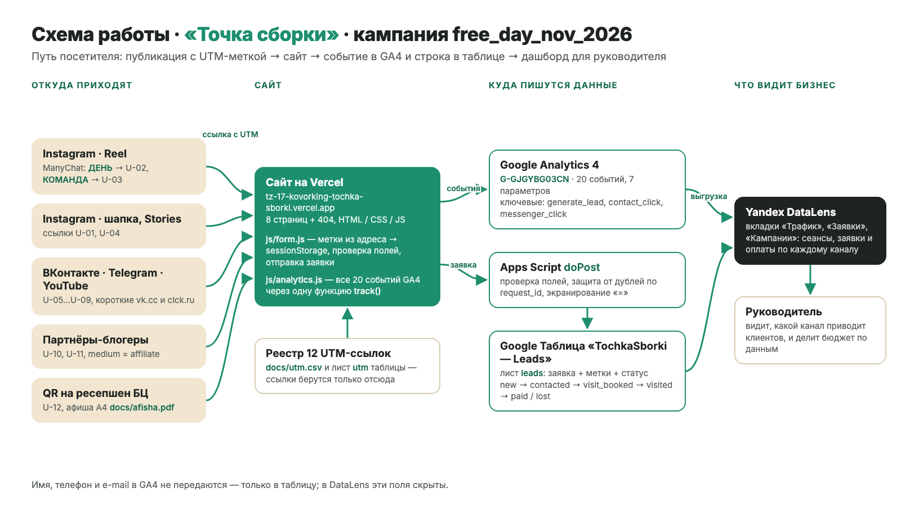

# Коворкинг «Точка сборки» — сайт и сквозная аналитика заявок

Курсовая работа по дисциплине ОП.03 «Информационные технологии», ТЗ № 17/2026.
Исполнитель: {{ФИО}}, группа {{ГРУППА}}.

Сайт кампании «Тест-день бесплатно» (`free_day_nov_2026`): каждый посетитель приходит с меткой
источника, каждая заявка попадает в Google Таблицу вместе с метками, а руководитель видит на
дашборде, какой канал приводит клиентов.



## Ссылки

| Что | Ссылка |
|---|---|
| Сайт | https://tz-17-kovorking-tochka-sborki.vercel.app |
| Репозиторий | https://github.com/dothefuture/tz-17-kovorking-tochka-sborki |
| Таблица заявок «TochkaSborki — Leads» | https://docs.google.com/spreadsheets/d/13Nn94ELkmP3sCfH8ftiLKCVR47HpSw0r3SDTAETSvsE/edit |
| Дашборд DataLens | не готов — ждёт накопления данных GA4 ([инструкция](docs/setup-datalens.md)) |
| Instagram и Reel с автоответом | https://www.instagram.com/yasdobnikov/ · https://www.instagram.com/reel/DfVjbClh6OE/ |
| ВКонтакте · Telegram · YouTube | не опубликованы ([тексты и ссылки готовы](docs/setup-social.md)) |
| Описание работы | [docs/opisanie.md](docs/opisanie.md) |
| Презентация к защите | [presentation/zashchita.pdf](presentation/zashchita.pdf) · исходник [zashchita.pptx](presentation/zashchita.pptx), [src/slides.html](presentation/src/slides.html) · [текст доклада](presentation/doklad.md) |

Ресурс GA4: `G-GJGYBG03CN` («ТОЧКА СБОРКИ — сайт», Москва, RUB). Доступ Viewer к ресурсу GA4 не
выдан — e-mail Заказчика неизвестен.

## Что сделано

| Часть | Результат |
|---|---|
| Сайт | 8 страниц + 404, статический HTML, Vercel, Lighthouse (mobile): 78 / 100 / 100 / 100 |
| GA4 | 20 событий, 7 пользовательских параметров, ключевые: `generate_lead`, `contact_click`, `messenger_click` |
| UTM | 12 ссылок в реестре `docs/utm.csv`, Instagram (шапка, Reel, Stories), QR на афише A4 |
| Заявки | форма → Apps Script → лист `leads`, проверка полей, защита от повторов, экранирование формул |
| Instagram | ManyChat, две ветки: `ДЕНЬ` и `КОМАНДА` |
| Отчёты | настройки Reports, Explore (воронка, путь), дашборд DataLens из трёх вкладок — в `docs/setup-*.md` |

## Технологии

HTML, CSS, JavaScript · Google Analytics 4 · Google Таблицы и Apps Script · ManyChat ·
Yandex DataLens · GitHub и Vercel. Сайт создан с помощью Claude Code
(запросы — в [docs/prompts.md](docs/prompts.md)).

## Структура

```text
index.html …                 8 страниц сайта и 404.html
css/style.css                общий стиль, адаптив 375 / 768 / 1280 px
js/analytics.js              все события GA4 (функция track, делегирование по data-event)
js/form.js                   UTM → sessionStorage, формы, проверка полей, fetch в Apps Script
js/main.js                   меню, калькулятор тарифа, промокод, панорама 360°
apps-script/Code.gs          приёмник заявок doPost, защита от дублей, setup() таблицы
docs/                        описание, схема, реестр UTM, события, записка, инструкции
screens/                     кадры-доказательства по разделам ТЗ, screens/kursovaya — для описания
presentation/                презентация к защите (PDF, PPTX, исходник и текст доклада)
```

## Как запустить локально

```bash
python -m http.server 8000
```

Открыть http://localhost:8000. Отладка событий: http://localhost:8000/?ga_debug=1 → GA4 DebugView.
Проверка калькулятора (И-13): 12 дней, 0 часов → «Гибкий»: 5 500 + 2 × 600 = **6 700 ₽**,
событие `tariff_calc` с `best_tariff = flex`.

Пересобрать презентацию после правок `presentation/src/slides.html`:

```bash
pip install playwright python-pptx && python -m playwright install chromium
python presentation/src/build.py
```

## Итог

Не получилось: страницы компании во ВКонтакте, Telegram и YouTube и ссылки партнёров (U-05…U-11)
не опубликованы; отчёты GA4, воронка и дашборд DataLens ждут накопления данных (ресурс запущен
5 ноября 2026 г.); доступ Viewer к GA4 и таблице не выдан — нет e-mail Заказчика.

Нейросеть использовалась для: генерации страниц сайта, стилей, изображений и PDF, кода `js/` и
`apps-script/`, реестра UTM, QR-кода и афиши, документации в `docs/`, схемы и презентации
(журнал — [docs/prompts.md](docs/prompts.md)).
