# Описание работы · ТЗ № 17/2026 · коворкинг «Точка сборки»

**Исполнитель:** Сдобников Андрей Андреевич, группа РПО 25/2
**Сайт:** https://tz-17-kovorking-tochka-sborki.vercel.app
**Репозиторий:** https://github.com/dothefuture/tz-17-kovorking-tochka-sborki
**Период проверок:** с 5 ноября 2026 г. (кампания `free_day_nov_2026`)

## 1. Задача заказчика

Коворкинг «Точка сборки» в центре Новоозёрска (бизнес-центр «Квадрант»: 60 мест в open space,
8 кабинетов, 3 переговорные, 140 резидентов) продвигается в Instagram, ВКонтакте, Telegram,
YouTube, через блогеров и афишу на ресепшен. Заявки приходят из разных каналов в разные места,
поэтому компания не знает, какой канал приводит клиентов, и не может распределить бюджет по данным.

С 1 ноября коворкинг запускает акцию: тест-день бесплатно и −15 % на первый месяц по промокоду
`FIRST15`. Задача — сайт акции, на котором виден источник каждого посетителя, одна таблица со
всеми заявками и дашборд, где руководитель сравнивает каналы.

## 2. Схема работы

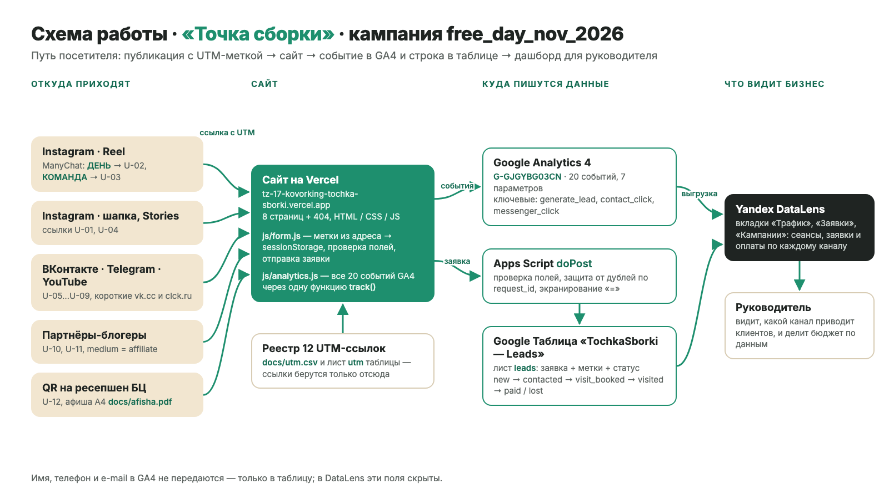

> **Что на кадре.** Путь данных проекта слева направо: Instagram, соцсети, партнёры и QR-код ведут на сайт по ссылкам с UTM; сайт отправляет события в GA4 и заявки через Apps Script в Google Таблицу; GA4 и таблица сходятся в дашборде DataLens.

Посетитель приходит из соцсетей, от партнёров или по QR-коду — всегда по ссылке с UTM-метками из
реестра `docs/utm.csv`. Сайт отправляет события в GA4, а заявку — через Apps Script в Google
Таблицу вместе с метками. Данные GA4 и таблицы собираются на дашборде DataLens.

<details>
<summary>Схема на Mermaid</summary>

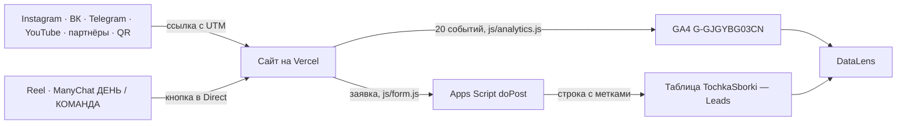

</details>

## 3. Сайт

Сайт из 8 страниц и страницы 404 (главная, тарифы, пространства, мероприятия, тест-день, заявка и
контакты, «спасибо», политика конфиденциальности) создан с помощью нейросети Claude Code и
доработан по результатам проверок: исправлена разметка карточек (заголовок внутри кнопки), пути
на странице 404, повторная отправка формы и экранирование формул в таблице (журнал —
[docs/prompts.md](prompts.md)). Статический HTML/CSS/JS без сборки, опубликован на Vercel и
обновляется после каждого push в `main`.

Фирменные цвета из ТЗ: зелёный `#1E8F6E`, песочный `#F2E6D0`, графит `#1F2422`. Адаптив 375 / 768 /
1280 px. На тарифах работает калькулятор: 12 дней без переговорной → «Гибкий», 6 700 ₽
(испытание И-13).

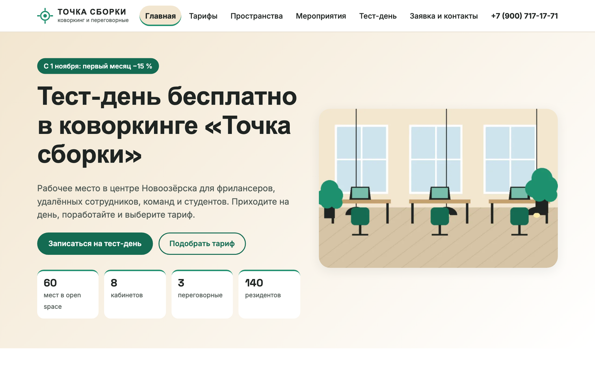

> **Что на кадре.** Главная `tz-17-kovorking-tochka-sborki.vercel.app` на ширине 1280 px: шапка с меню из шести пунктов и телефоном, первый экран с предложением тест-дня и кнопкой заявки. Цвета — фирменные из ТЗ: зелёный `#1E8F6E`, песочный `#F2E6D0`, графит `#1F2422`.

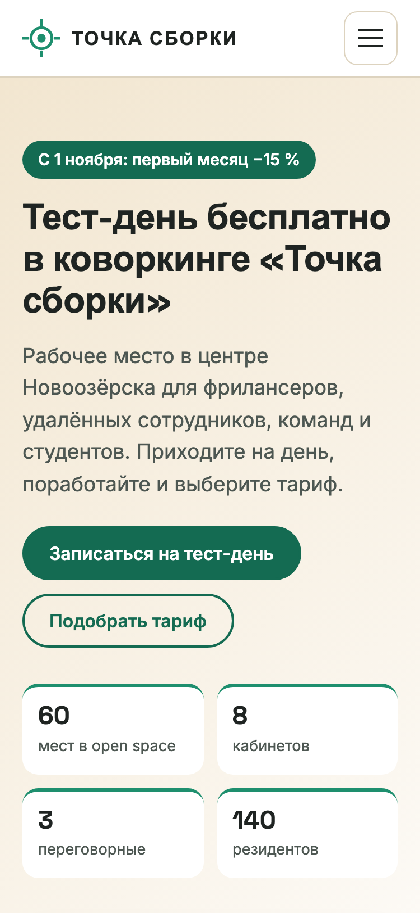

> **Что на кадре.** Та же главная на ширине 375 px: меню свёрнуто в кнопку, текст идёт в одну колонку, под заголовком кнопки «Записаться на тест-день» и «Подобрать тариф», ниже карточки «60 мест в open space», «8 кабинетов», «3 переговорные», «140 резидентов». Горизонтальной прокрутки нет.

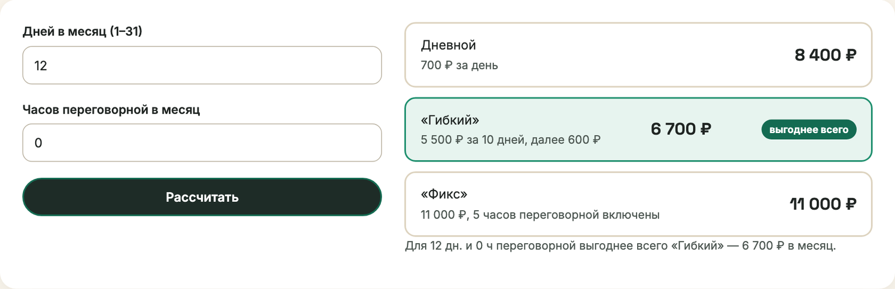

> **Что на кадре.** Калькулятор на `tariffs.html`: введено 12 дней в месяц без часов переговорной, калькулятор выбрал тариф «Гибкий» за 6 700 ₽ (испытание И-13 из ТЗ). При расчёте в GA4 уходит `tariff_calc` с параметром `best_tariff = flex`.

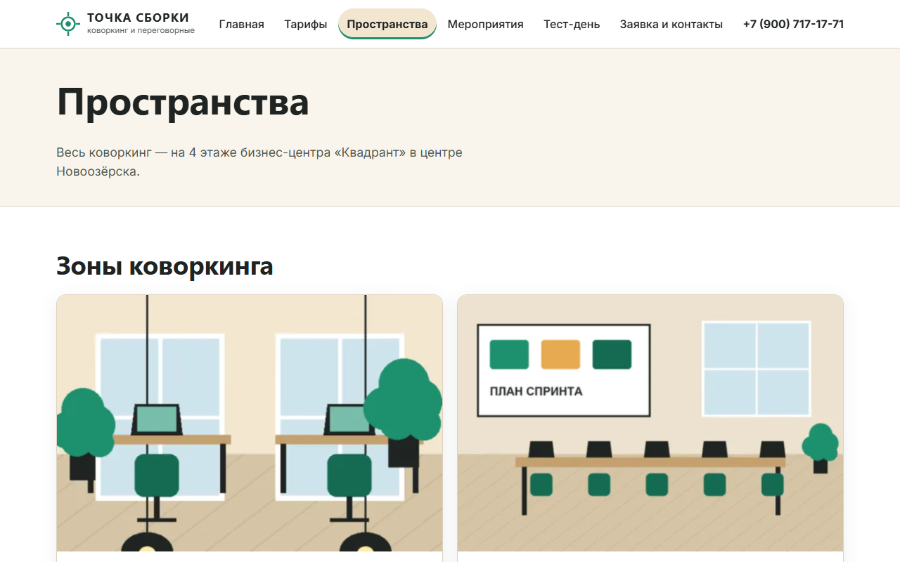

> **Что на кадре.** Страница `spaces.html`: зоны коворкинга на 4 этаже БЦ «Квадрант». Открытие карточки зоны отправляет `space_view` с параметром `space_type`, кнопка панорамы — `tour_open`.

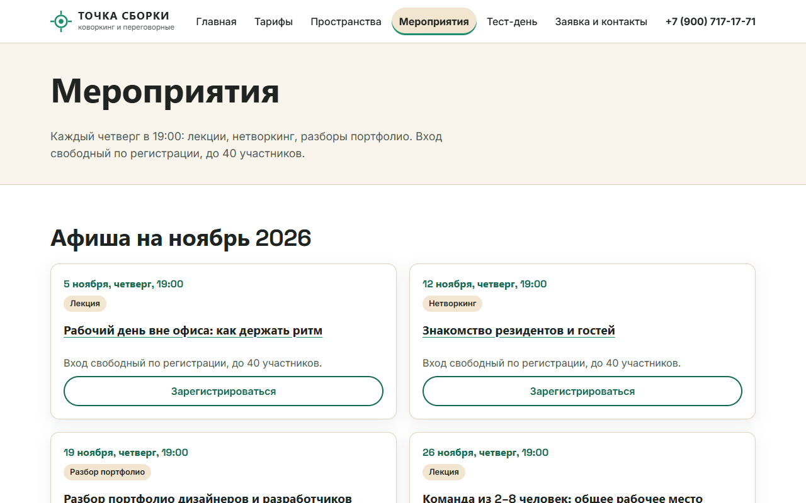

> **Что на кадре.** Страница `events.html`: афиша четвергов на ноябрь 2026 (5, 12, 19, 26 ноября). Кнопка «Зарегистрироваться» открывает форму, после успешной записи уходит `event_register` с `event_id`.

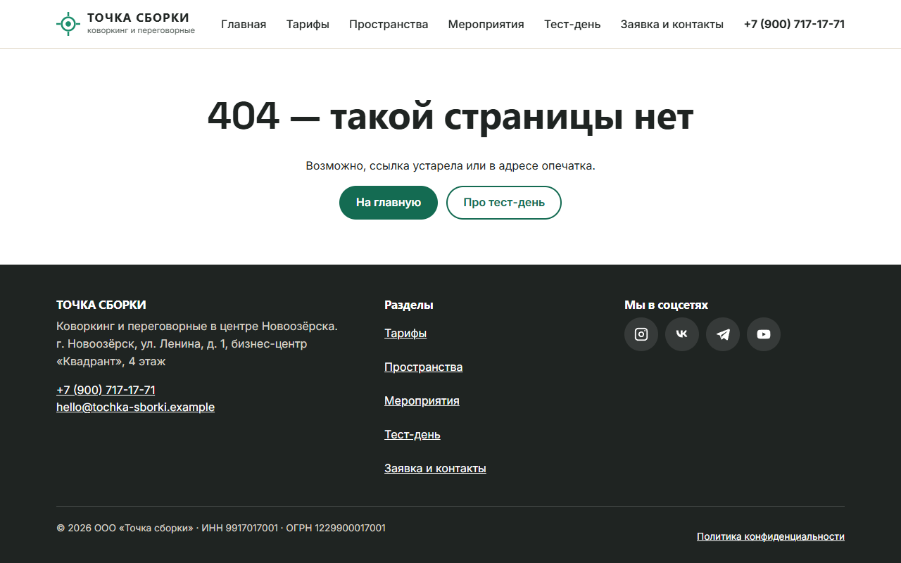

> **Что на кадре.** Своя страница 404 по несуществующему адресу: в фирменном стиле, с меню и ссылкой на главную, чтобы посетитель с битой ссылки не уходил с сайта.

Lighthouse для главной (mobile): Performance 78, Accessibility 100, Best Practices 100, SEO 100.

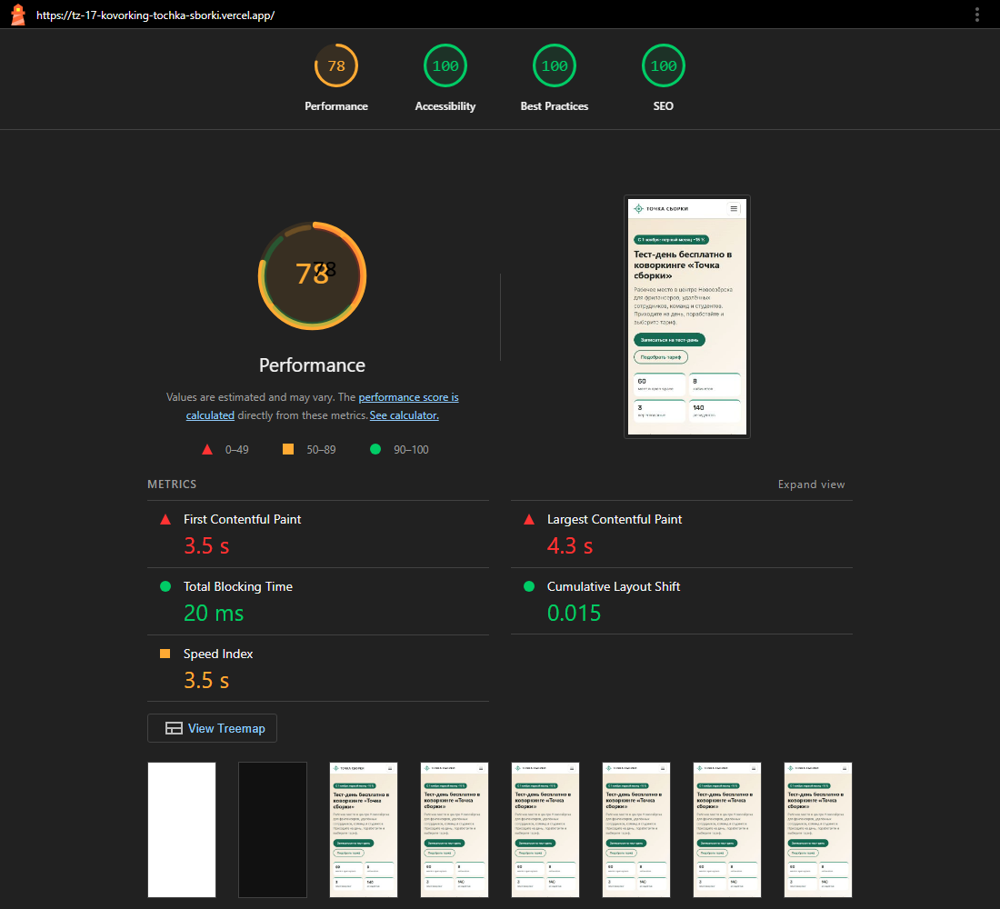

> **Что на кадре.** Отчёт Lighthouse для главной в режиме mobile: Performance 78, Accessibility 100, Best Practices 100, SEO 100. Полный отчёт — `screens/lighthouse/index-mobile.report.html`.

## 4. Аналитика GA4

Ресурс «ТОЧКА СБОРКИ — сайт», Measurement ID `G-GJGYBG03CN`, часовой пояс Москва, валюта RUB.
Тег стоит первым в `<head>` всех 9 страниц. Включена расширенная статистика (все 7 переключателей).

Настроено 20 событий: 6 автоматических (`page_view`, `scroll`, `click`, `file_download`,
`form_start`, `form_submit`), рекомендованное `generate_lead` и 13 своих (`cta_click`,
`space_view`, `select_tariff`, `tariff_calc`, `event_view`, `event_register`, `tour_open`,
`contact_click`, `messenger_click`, `social_click`, `form_error`, `promo_copy`, `map_open`).
Ключевые события: `generate_lead`, `contact_click`, `messenger_click`. Создано 7 пользовательских
параметров (`button_name`, `page_section`, `space_type`, `best_tariff`, `event_id`, `lead_tariff`,
`messenger`). Полная таблица с файлом и строкой каждого события — [docs/events.md](events.md).

Все вызовы `gtag('event', …)` собраны в одной функции `track()` (`js/analytics.js:43`). Клики по
элементам с атрибутом `data-event` ловит один общий обработчик, параметры берутся из `data-*`.
Имя, телефон и e-mail в GA4 не попадают: ключи `name`, `phone`, `email` отбрасываются.

```js
// js/form.js:189 — событие уходит только после ответа приёмника {"ok": true}
track('generate_lead', { lead_tariff: data.tariff, team_size: data.team_size, lead_source: data.utm_source });
```

Режим отладки включается адресом `?ga_debug=1` — события видны в DebugView.

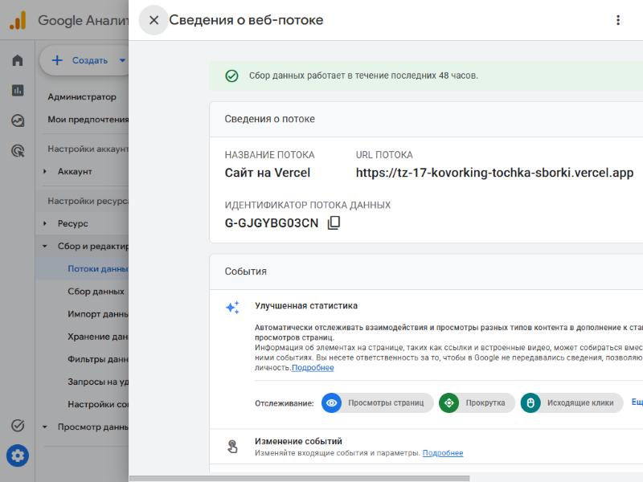

> **Что на кадре.** GA4 → Администратор → Потоки данных → «Сайт на Vercel». Ресурс «ТОЧКА СБОРКИ — сайт», адрес потока `https://tz-17-kovorking-tochka-sborki.vercel.app`, идентификатор `G-GJGYBG03CN`. Зелёная плашка «Сбор данных работает в течение последних 48 часов» подтверждает, что тег на сайте отправляет данные. Ниже включена улучшенная статистика: просмотры страниц, прокрутка, исходящие клики и другие.

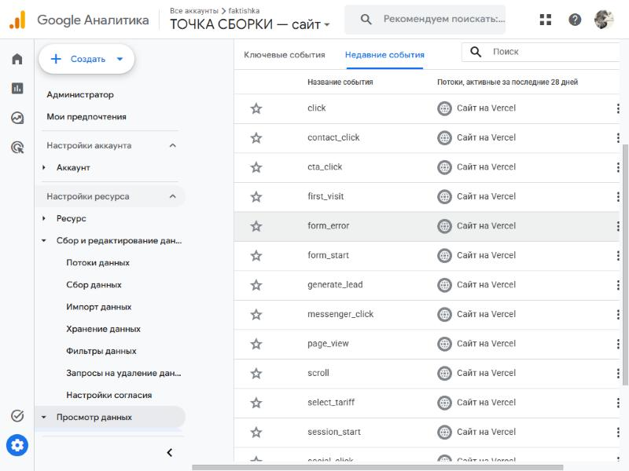

> **Что на кадре.** Администратор → События → «Недавние события»: события, которые сайт уже прислал в ресурс, — автоматические (`page_view`, `scroll`, `click`, `form_start`, `first_visit`, `session_start`) и свои (`contact_click`, `cta_click`, `form_error`, `generate_lead`, `messenger_click`, `select_tariff`, ниже `social_click`). Звёздочка слева отмечает событие как ключевое.

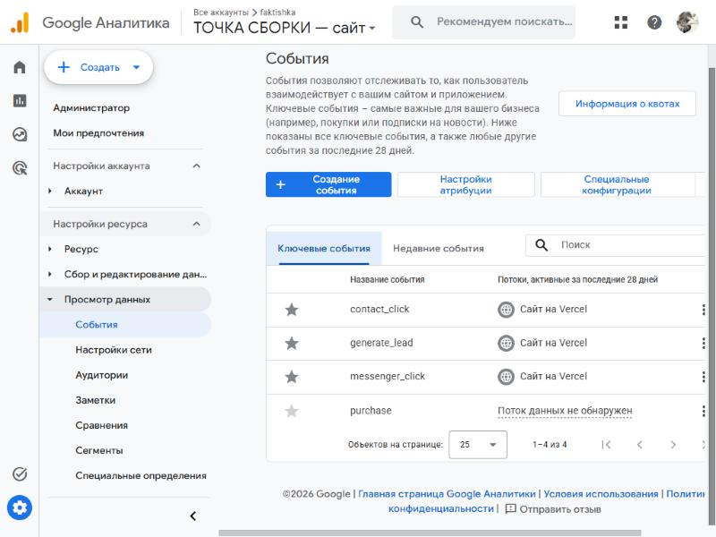

> **Что на кадре.** Администратор → События → вкладка «Ключевые события»: звёздочкой отмечены `contact_click`, `generate_lead` и `messenger_click` — заявка с сайта, клик по телефону или почте и переход в мессенджер. Их GA4 считает конверсиями в отчётах. `purchase` — системное событие GA4, на сайте не используется (поток данных не обнаружен).

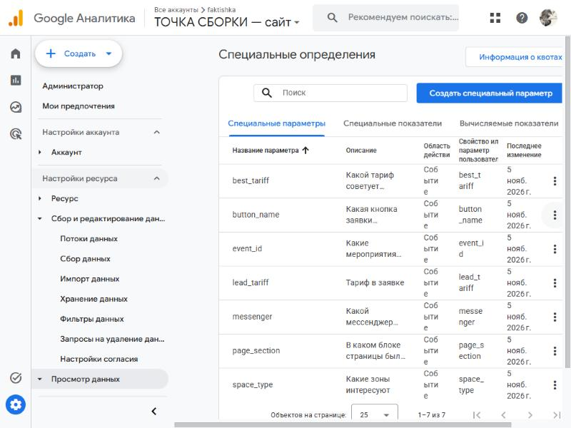

> **Что на кадре.** Администратор → Специальные определения: 7 пользовательских параметров с областью действия «Событие», созданы 5 ноября 2026 г. — `best_tariff`, `button_name`, `event_id`, `lead_tariff`, `messenger`, `page_section`, `space_type`. Без них значения параметров не появились бы в отчётах.

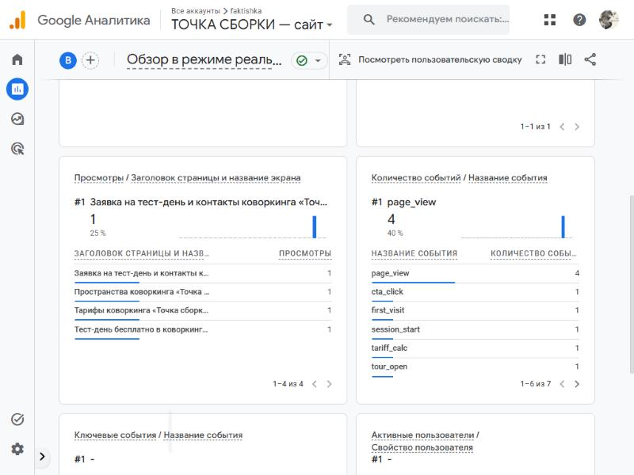

> **Что на кадре.** Обзор в режиме реального времени во время проверки: переход по ссылке U-02 на `free-day.html`, клик по кнопке «Выбрать дату тест-дня», расчёт в калькуляторе и открытие панорамы. Слева 4 просмотренные страницы (заявка, пространства, тарифы, тест-день), справа события `page_view` 4, `cta_click`, `tariff_calc`, `tour_open` — свои события доходят до GA4 сразу.

## 5. UTM-ссылки и соцсети

В реестре 12 ссылок (`docs/utm.csv`, лист `utm` таблицы, где полная ссылка собирается формулой):
Instagram — шапка профиля, два автоответа под Reel и Stories (U-01…U-04), ВКонтакте — пост и
событие (U-05, U-06), Telegram — канал и чат фрилансеров (U-07, U-08), YouTube (U-09), два
партнёра-блогера (U-10, U-11) и QR-код на ресепшен бизнес-центра (U-12, афиша A4
[docs/afisha.pdf](afisha.pdf)).

Правила меток: всё латиницей в нижнем регистре, `utm_medium` — `social`, `affiliate` или `qr`,
`utm_campaign` — повод и месяц (`free_day_nov_2026`, `team_office_nov_2026`,
`networking_thu_nov_2026`). Сайт сохраняет метки первой страницы в `sessionStorage`, поэтому
источник не теряется, даже если посетитель перешёл на другую страницу до заявки.

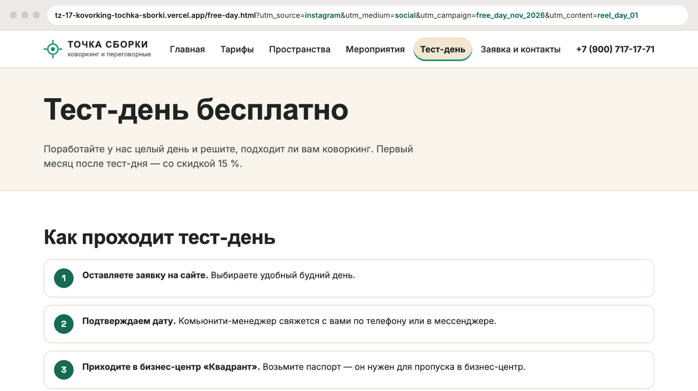

> **Что на кадре.** Страница `free-day.html`, открытая по ссылке U-02 из кнопки «Тест-день» в Direct. В адресной строке все четыре метки: `utm_source=instagram`, `utm_medium=social`, `utm_campaign=free_day_nov_2026`, `utm_content=reel_day_01`. Сайт сохраняет их в `sessionStorage` и подставляет в заявку.

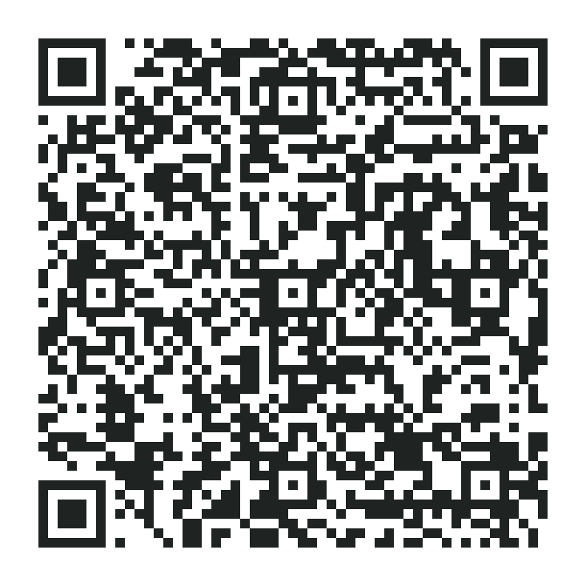

> **Что на кадре.** QR-код ссылки U-12 с афиши A4 ([afisha.pdf](afisha.pdf)): ведёт на `free-day.html` с метками `reception_qr` / `qr` / `free_day_nov_2026`, поэтому посетители с ресепшен бизнес-центра видны отдельным источником.

## 6. Заявки

Форма на `contacts.html` проверяет поля в браузере (имя, телефон в формате +7 и 10 цифр, тариф,
размер команды, согласие на обработку данных) и показывает ошибку у поля, а в GA4 уходит
`form_error`. Затем `fetch` отправляет заявку в веб-приложение Apps Script вместе с `request_id` и
четырьмя метками.

Приёмник `apps-script/Code.gs` (функция `doPost`) ещё раз проверяет поля и длину, отклоняет
значения не из списков, экранирует строки, начинающиеся с `=`, и записывает строку в лист `leads`
(13 столбцов: заявка, метки, `created_at` и `status = new`). Повторная отправка с тем же
`request_id` не создаёт дубль — это защищено блокировкой `LockService`. Приёмник работает: на
запрос GET отвечает `{"ok":true,"service":"tochka-sborki-leads"}`.

Статусы заявки: `new → contacted → visit_booked → visited → paid` или `lost` — по ним DataLens
считает, сколько заявок из каждого канала дошли до оплаты.

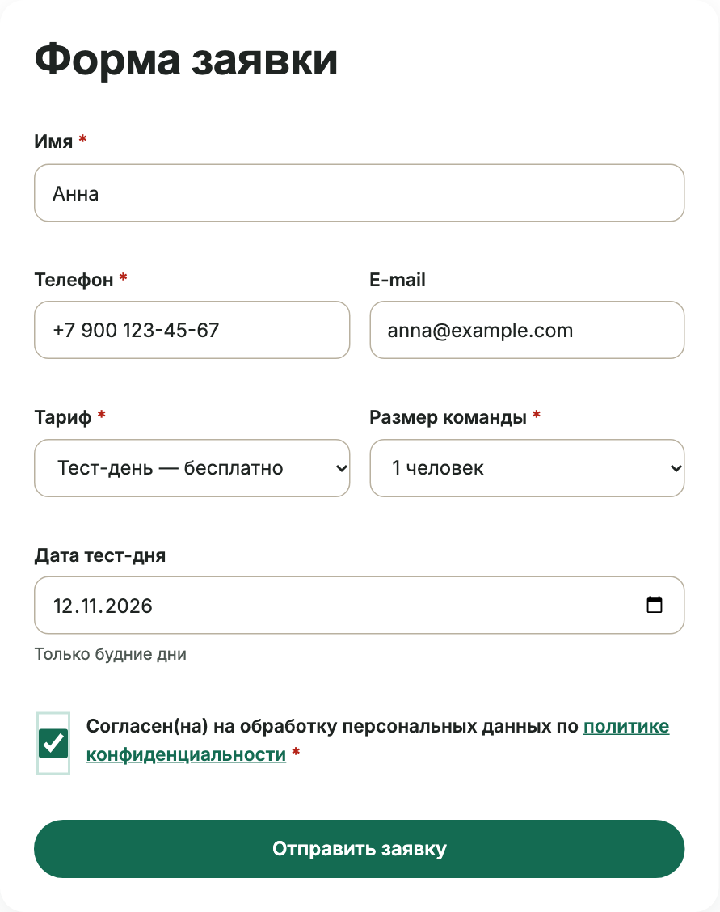

> **Что на кадре.** Форма на `contacts.html` перед отправкой тестовой заявки: имя, телефон в формате +7, e-mail, тариф «Тест-день — бесплатно», размер команды «1 человек», дата 12.11.2026 (только будни) и отмеченное согласие на обработку данных. Данные тестовые.

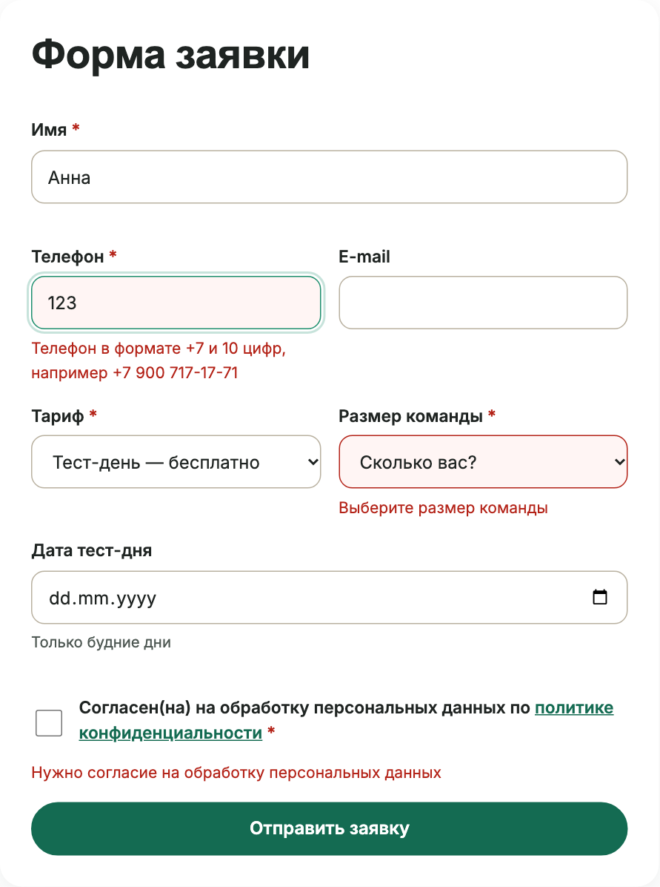

> **Что на кадре.** Та же форма с ошибками: телефон «123» подсвечен и подписан «Телефон в формате +7 и 10 цифр», не выбран размер команды, не отмечено согласие. Заявка не уходит, а в GA4 отправляется `form_error` с `field_name` и `error_type`.

## 7. Автоответы в Instagram

Опубликован Reel «Один день в коворкинге за 30 секунд»
(https://www.instagram.com/reel/DfVjbClh6OE/). В ManyChat работают две автоматизации на этот Reel:

- комментарий со словом **ДЕНЬ** → публичный ответ в комментариях и сообщение в
  Direct с кнопкой «Тест-день» → ссылка U-02 на `free-day.html`;
- комментарий со словом **КОМАНДА** → сообщение про кабинеты на 4 и 8 человек с кнопкой «Кабинеты» →
  ссылка U-03 на `spaces.html#office` (кампания `team_office_nov_2026`).

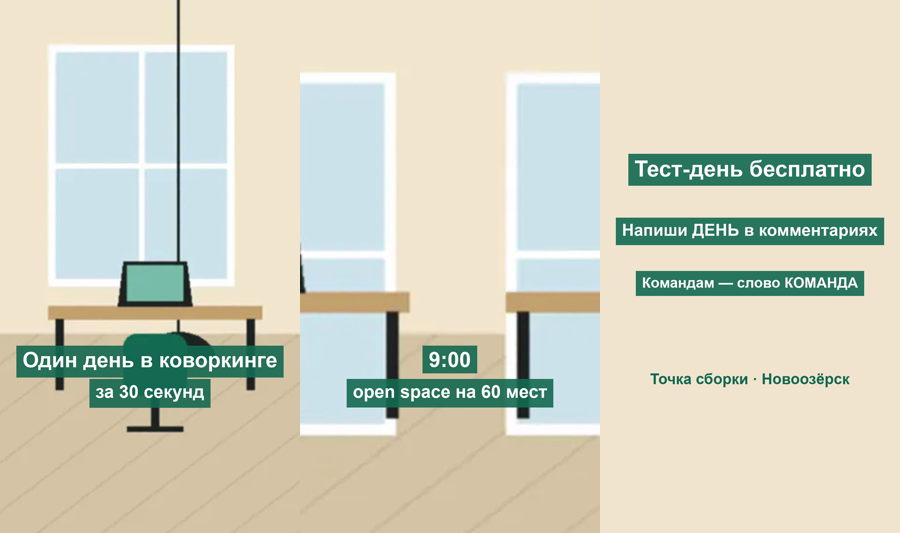

> **Что на кадре.** Три кадра Reel «Один день в коворкинге за 30 секунд»: заставка, «9:00 — open space на 60 мест» и финальный призыв «Напиши ДЕНЬ в комментариях», «Командам — слово КОМАНДА». Эти слова и ловит ManyChat.

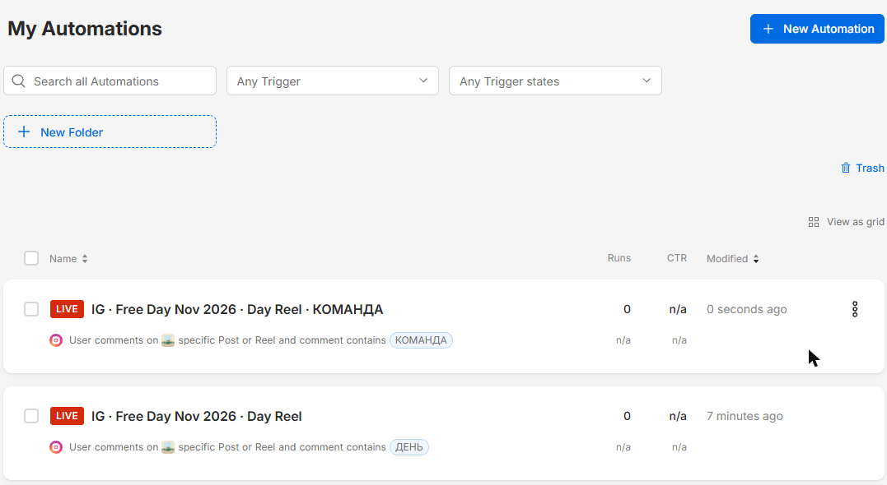

> **Что на кадре.** ManyChat → My Automations: две автоматизации со статусом LIVE — «IG · Free Day Nov 2026 · Day Reel» (слово `ДЕНЬ`) и «… · КОМАНДА» (слово `КОМАНДА`). Обе срабатывают на комментарий под конкретным Reel.

## 8. Отчёты и дашборд

Ресурс GA4 и автоответы запущены 5 ноября 2026 г. GA4 обрабатывает данные до 24–48 часов, поэтому
отчёты строятся по готовым настройкам после накопления данных:

- Reports: Traffic acquisition по Session source / medium и Session campaign, Landing page, Events,
  Key events, Tech; detail-отчёт «Кампания free_day_nov_2026» в Library;
- Explore: «Свободная форма» с сегментами Instagram и Direct, открытая и закрытая воронка
  `page_view → space_view → cta_click → form_start → generate_lead`, путь от `free-day.html` и
  обратный путь от `generate_lead`;
- дашборд DataLens из трёх вкладок: «Трафик», «Заявки» (`COUNTD([request_id])`, статусы),
  «Кампании» (сеансы и `generate_lead` из GA4 рядом с заявками и оплатами из таблицы по source и
  campaign). Поля `name`, `phone`, `email` в датасете скрыты.

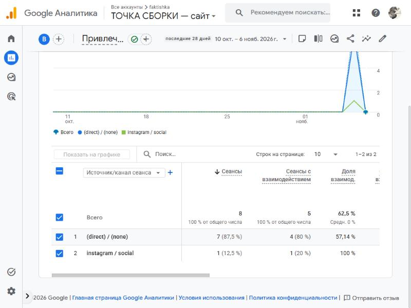

> **Что на кадре.** Отчёты → Привлечение трафика, параметр «Источник/канал сеанса», последние 28 дней (10 окт. – 6 нояб. 2026 г.): 8 сеансов, из них `instagram / social` — 1 сеанс с вовлечением 100 %, это переход из автоответа ManyChat. Остальные 7 — `(direct) / (none)`: проверки сайта без меток.

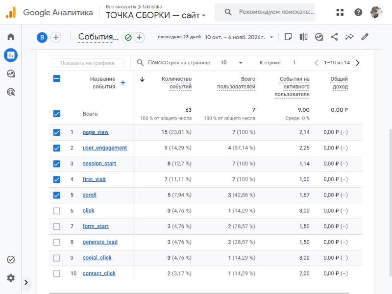

> **Что на кадре.** Отчёты → События: всего 63 события от 7 пользователей. `generate_lead` — 3 раза у 2 пользователей (тестовые заявки), также видны `form_start`, `click`, `social_click`, `contact_click`. Данных пока мало: ресурс работает с 5 ноября.

Пошаговые настройки — [docs/setup-ga4.md](setup-ga4.md) и [docs/setup-datalens.md](setup-datalens.md),
итоговые числа и вывод — в аналитической записке [docs/report.md](report.md).

## 9. Что получил бизнес

| Было | Стало |
|---|---|
| заявки приходят в разные места | все заявки в одной таблице со статусом от `new` до `paid` |
| источник клиента неизвестен | у каждой заявки есть `utm_source`, `utm_medium`, `utm_campaign`, `utm_content` |
| ответы на комментарии вручную | ManyChat отвечает сразу и ведёт на сайт по ссылке с меткой |
| бюджет делится «по ощущениям» | на дашборде видно сеансы, заявки и оплаты по каждому каналу |
| нет понятной цены для клиента | калькулятор сам подбирает выгодный тариф |

Рекомендация заказчику: через две недели кампании сравнить на вкладке «Кампании» число заявок в
статусе `paid` на 100 сеансов по каналам и перенести бюджет блогеров в канал с лучшим значением;
до этого — держать ссылки только из реестра, иначе канал попадёт в `direct`.

## 10. Итог

Сделано: сайт из 8 страниц и 404 на Vercel, 20 событий GA4 и 7 параметров, реестр 12 UTM-ссылок,
QR-код и афиша, форма → Apps Script → Google Таблица с защитой от дублей, Reel и две ветки
автоответов ManyChat.

Не получилось к сдаче: страницы компании во ВКонтакте, Telegram и YouTube и ссылки партнёров
(U-05…U-11) не опубликованы; отчёты GA4, воронка и дашборд DataLens ждут накопления данных;
доступ Viewer к GA4 и таблице не выдан — нет e-mail заказчика.

ИИ использовался для: генерации страниц, стилей и изображений, кода `js/` и `apps-script/`,
реестра UTM, QR-кода и афиши, документации, схемы и презентации. Вручную — аккаунты GA4, Google,
Vercel, Instagram и ManyChat, публикация Reel и проверки.
